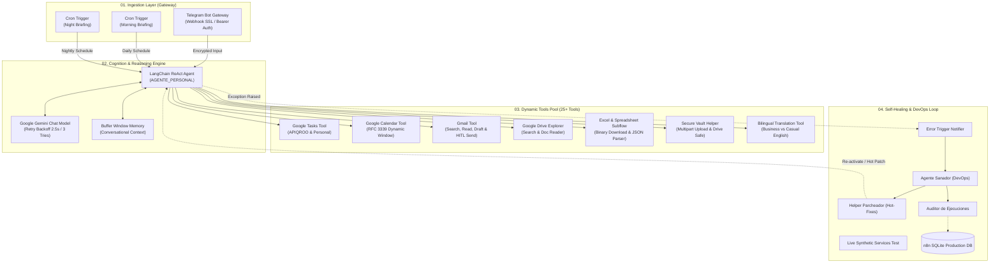

# Autonomous AI Agent & Self-Healing Ecosystem | n8n Enterprise Architecture

[](https://n8n.io)
[](https://langchain.com)
[](https://ai.google.dev)
[](https://azure.microsoft.com)
[](https://www.docker.com)
[]()

> **Live Interactive Showcase:** [Ver Portafolio Web Interactivo](https://king1angel.github.io/n8n-architecture-showcase/)  
> **Arquitectura y Desarrollo:** Ing. Angel Peña ([@King1Angel](https://github.com/King1Angel))

---

## 📌 Resumen Ejecutivo

Este proyecto documenta la arquitectura técnica y operacional de un **Ecosistema de Agentes de IA Autónomos de grado empresarial**, implementado sobre una instancia dedicada de **n8n en Microsoft Azure**. 

El sistema integra un agente inteligente con **más de 25 herramientas dinámicas**, razonamiento multi-paso (ReAct), persistencia en memoria conversacional, procesamiento desacoplado de datos binarios (Excel `.xlsx` / `.csv`), almacenamiento protegido en bóveda confidencial y un **bucle cerrado de DevOps Auto-Sanador** capaz de diagnosticar fallos e inspeccionar bases de datos en tiempo real.

---

## 🏛️ Diagrama de Arquitectura del Sistema



---

## 🛠️ Matriz de Capacidades y Herramientas (25+ Herramientas)

| Dominio | Herramientas Clave | Método / Protocolo | Valor Técnico / Operativo |
| :--- | :--- | :--- | :--- |
| **Productividad & Tareas** | `Crear Tarea`, `Leer Tareas`, `Actualizar Tarea`, `Eliminar Tarea` | Google Tasks REST API | Gestión unificada de pendientes con formateo estricto (MAYÚSCULAS sin asteriscos en tareas APIQROO). |
| **Agenda & Calendario** | `Leer Calendario`, `Crear Evento`, `Actualizar Evento`, `Eliminar Evento` | Google Calendar API (RFC 3339) | Búsqueda dinámica con ventana temporal contextualizada a zona horaria `America/Cancun`. |
| **Comunicaciones (Gmail)**| `Buscar Correos`, `Leer Correo`, `Enviar Correo` | Gmail OAuth2 REST API | **Human-in-the-Loop (HITL):** Prohibición estricta de envío directo; presentación de borrador y confirmación explícita. |
| **Documentos & Archivos** | `Buscar en Drive`, `Leer Documento Drive`, `Crear Carpeta Drive` | Google Drive v3 API | Indexación por palabras clave, exportación de Google Docs a texto plano y generación de enlaces directos. |
| **Hojas de Cálculo & Excel**| `Leer Hoja de Calculo o Excel` | Subflujo Desacoplado + n8n Spreadsheet Node | Descarga de binarios `.xlsx`/`.csv`, extracción de tablas, inventarios y búsqueda de números de activo. |
| **Seguridad & Bóveda** | `Guardar Nota Privada`, `Buscar Notas Privadas`, `Leer Nota Privada` | Multipart Upload en carpeta protegida | Almacenamiento seguro de credenciales y notas con acceso restringido exclusivo para el agente. |
| **DevOps & Auto-Sanación** | `Auditar Ejecución`, `Leer Workflow`, `Parchear Nodo`, `Probar Servicios en Vivo`, `Control de Flujos` | n8n Public API + SQLite | Monitoreo sintético, análisis de stack traces y corrección de nodos en caliente sin downtime. |
| **Lingüística & Global** | `Traductor de Idiomas e Inglés` | Motor NLP Contextual | Traducción bidireccional profesional (Business English vs. Casual). |

---

## 💡 Decisiones de Ingeniería y Retos Resueltos

### 1. Resiliencia ante Saturación de APIs (Gemini 503 / 429)
* **Desafío:** Las cargas pico de proveedores de IA pueden arrojar errores temporales de alta demanda.
* **Solución:** Configuración de políticas de **reintento automático (`retryOnFail: true`) con 3 intentos y backoff de 2500ms** tanto en el nodo del LLM como en el nodo Agent de LangChain, eliminando fallos hacia el usuario final.

### 2. Procesamiento de Binarios Heterogéneos (Excel `.xlsx` / `.csv`)
* **Desafío:** Los LLMs operan en texto plano y no pueden procesar directamente streams binarios descargados de Google Drive.
* **Solución:** Arquitectura de micro-servicio desacoplado (`Drive - Leer Excel Helper`, ID `V87ExcelReadHelper`). El agente invoca el webhook con el `fileId`, el subflujo descarga el stream con `alt=media`, el nodo nativo `SpreadsheetFile` parsea las celdas y un nodo de código devuelve un JSON estructurado acotado a 250 filas para proteger la ventana de contexto.

### 3. Patrón DevOps Auto-Sanador (Self-Healing Loop)
* **Desafío:** Mantener alta disponibilidad 24/7 sin necesidad de inspeccionar manualmente la consola ante errores de configuración.
* **Solución:** Un flujo de captura global (`Error Trigger`) que ante cualquier fallo activa el subagente DevOps (`Agente Sanador`). Este agente inspecciona la base de datos de ejecuciones en SQLite, localiza el nodo fallido y puede aplicar parches o re-activar el flujo de forma desatendida.

---

## 📂 Inventario de Workflows en Producción

```
├── S75ONAhqZjJPJL8r   -> AGENTE_PERSONAL (36 nodos, Núcleo del Agente ReAct)
├── V87ExcelReadHelper -> Drive - Leer Excel Helper (5 nodos, Parser de hojas de cálculo)
├── MT6Enm1MgdmCKQke   -> Bóveda - Guardar Nota Helper (3 nodos, Multipart upload)
├── xkrTEAZ4aM0SUCtt   -> Sanador - Helper Parcheador (5 nodos, Hot-patching API)
├── O2j5Pj6o2S3iA0r8   -> Servicios - Probador en Vivo (7 nodos, Health Check)
├── 7gRArLe2B7qR69u1   -> Error Trigger - Notificador y Sanador (8 nodos, Manejo de fallos)
├── LJF3yWXxfssiPTpc   -> Morning Briefing (19 nodos, Automatización matutina)
├── JiuIIt8QblWizzcW   -> Night Briefing (10 nodos, Automatización nocturna)
└── 6DNMhZUtWhTAE3Mm   -> Watchdog - Monitor de Servicios (8 nodos, Standby)
```

---

## 🚀 Despliegue e Infraestructura

* **Host:** Instancia Linux en Microsoft Azure Cloud (`azureuser@n8n-angel.northcentralus.cloudapp.azure.com`)
* **Contenedor:** Docker (`n8nio/n8n:latest`) con volumen persistente `n8n_data`.
* **Proxy & Red:** Configuración optimizada `N8N_PROXY_HOPS=1` con terminación SSL y reverse proxy para evitar rate-limits de loopback.
* **Base de Datos:** SQLite local montada sobre volumen con normalización ISO 8601 en triggers de versión.

---

## 👨‍💻 Autor

**Ing. Angel Peña**  
*AI Engineer & Automation Architect*  
* GitHub: [@King1Angel](https://github.com/King1Angel)
